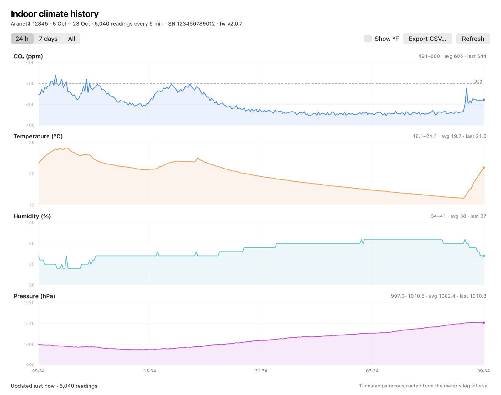

# aranet4-bluetooth

Read an Aranet4 CO₂ monitor over Bluetooth Low Energy from a Mac — no cloud, no
vendor app, no account.

Two complete, independent implementations. Either one stands on its own:

| | Implementation | Best for |
|---|---|---|
| 🖥️ | [**AranetBar**](swift/) — single-file Swift menu bar app | CO₂ at a glance, always running |
| 🐍 | [**aranet.py**](python/) — scriptable Python CLI + library | Automation, JSON, history export |

Both decode the same data and produce identical values. The wire format is
documented in [PROTOCOL.md](PROTOCOL.md).

## A neat property of this device

The Aranet4 **broadcasts every measurement in its BLE advertisement**. So you can
read it without ever opening a connection — which means no battery cost and no
fighting the Aranet phone app for the BLE link. That is how the menu bar app
keeps its live reading. Both clients connect over GATT only when you want the
full 13-byte characteristic, or the meter's on-board history, which holds about
17 days at the default interval.

---

## 🖥️ Swift — AranetBar


A menu bar utility in the spirit of the *singlefilemenuapps* collection: one
file, one purpose, nothing beyond system frameworks.

**Prebuilt:** grab `AranetBar-<version>.zip` from
[Releases](https://github.com/The-Focus-AI/aranet4-bluetooth/releases/latest),
unzip, and drag to `/Applications`. It is ad-hoc signed, not notarized, so on
first launch use right-click → **Open** (or `xattr -dr com.apple.quarantine
AranetBar.app`).

Or build it yourself:

```bash
cd swift
./aranetbar.swift          # run it directly
```

or build a proper bundle, which gets its own Bluetooth permission entry:

```bash
cd swift
./build.sh
open AranetBar.app
```

The menu bar shows a colour-coded dot plus the current CO₂; the dropdown breaks
out temperature (°C and °F), humidity, pressure, battery, signal and staleness,
and opens a **history window** with interactive 17-day CO₂, temperature,
humidity and pressure graphs (24 h / 7 days / all), plus CSV export. Live
readings stay advertisement-only, scanned on a 5 s / 20 s duty cycle; the app
connects briefly and only when you open or refresh the history window.

### History window

Pick **History…** (⌘H) from the menu bar. The window shows the meter's full
17.5-day ring buffer as stacked CO₂, temperature, humidity and pressure panels,
with 24 h / 7 days / All ranges, hover readouts, a °C/°F toggle and CSV export.
The newest snapshot is cached, so it opens instantly and still works when the
meter is out of range.




*Sample data from a real Aranet4; serial redacted.*

Headless equivalents, from `swift/`:

```bash
./aranetbar.swift --history                              # print a summary
./aranetbar.swift --history --history-csv aranet-history.csv
./aranetbar.swift --history --history-json aranet-history.json
./aranetbar.swift --history --history-days 7             # only the last week
./aranetbar.swift --render-history aranet-history-window.png
```

→ [Full details](swift/README.md)

## 🐍 Python — aranet.py

A CLI and importable parser. Connects over GATT *or* decodes the advertisement,
and emits either a readable line or JSON.

```bash
python3 -m venv .venv
.venv/bin/pip install -r python/requirements.txt

.venv/bin/python python/aranet.py scan     # is the meter visible?
.venv/bin/python python/aranet.py read     # one connected reading
.venv/bin/python python/aranet.py adv      # passive, no connection
```

```
09:12:59  CO2  691 ppm  19.45 C   999.9 hPa  RH  38%  bat  80%  green   age  212s/300s
```

```bash
.venv/bin/python python/aranet.py watch --poll 10   # poll while connected
.venv/bin/python python/aranet.py adv-watch         # passive stream
.venv/bin/python python/aranet.py --json read       # JSON output
.venv/bin/python python/aranet.py read --fahrenheit

.venv/bin/python python/aranet.py history           # download log → CSV
.venv/bin/python python/aranet.py history --days 7  # just the last week
```

→ [Full details](python/README.md)

---

## Repo layout

```
python/       Python CLI, parser and tests
swift/        AranetBar menu bar app, build script and icon generator
PROTOCOL.md   The BLE wire format, reverse-engineered and tagged verified/inferred
```
## Requirements

- **Swift app:** macOS 13+, Xcode command line tools (`swiftc`). First launch
  asks for Bluetooth permission — allow it.
- **Python client:** Python 3.10+, `bleak`. Your terminal needs Bluetooth
  permission (System Settings → Privacy & Security → Bluetooth); without it the
  scan silently returns nothing.
- **The meter:** paired once in System Settings → Bluetooth.

## Caveats

- **One connection at a time.** The Aranet phone app will fight you for the link;
  use the passive (`adv`) path if you need both at once.
- **Readings only change every `interval`** (300 s by default), so polling faster
  is pointless. Both implementations report `age` so you can tell how fresh the
  data is instead of being misled.
- **History timestamps are reconstructed.** The meter stores readings, not
  clock times: it knows how long ago the newest one was taken and the logging
  interval, so older entries are counted backwards. They are accurate to a few
  seconds unless the interval changed or the meter was off (see
  [PROTOCOL.md §6](PROTOCOL.md).

## License

[MIT](LICENSE) © 2026 Focus AI. The protocol documentation is prose, not
reverse-engineered code — use it freely.
