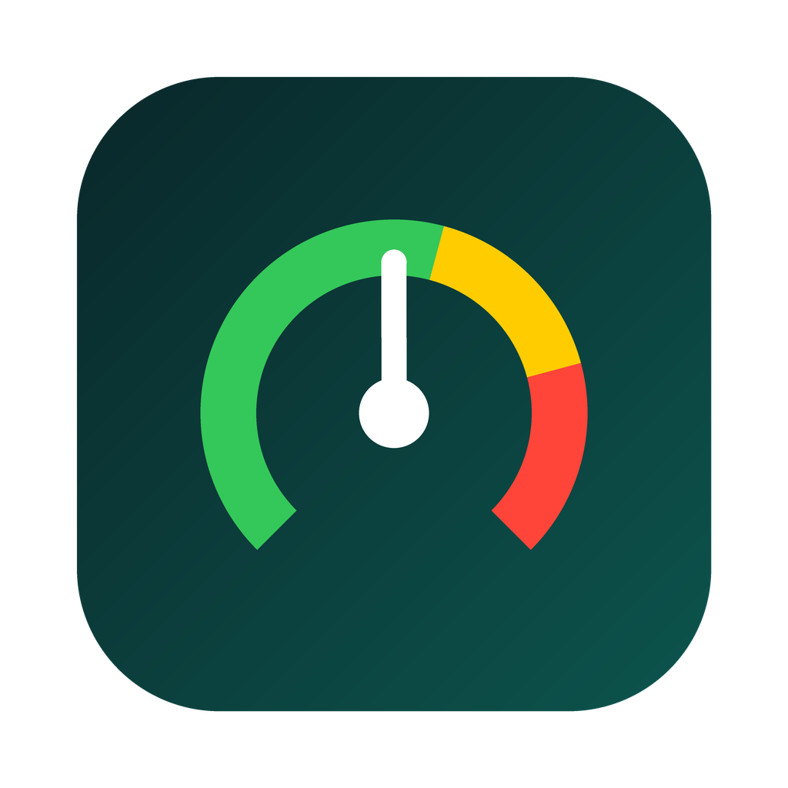
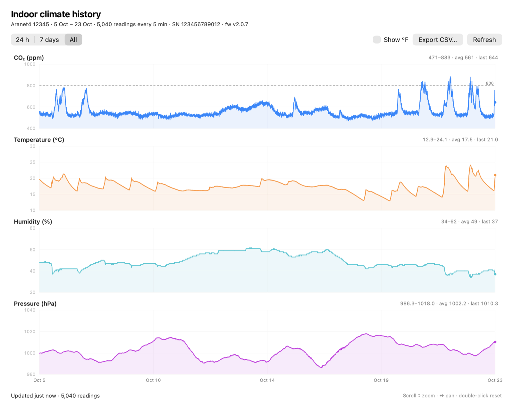

# AranetBar — macOS menu bar app

A single-file Swift menu bar utility that shows your Aranet4's CO₂, temperature,
humidity, pressure and battery — straight from the device's Bluetooth
advertisement.



## Install

**Prebuilt:** download `AranetBar-<version>.zip` from
[Releases](https://github.com/The-Focus-AI/aranet4-bluetooth/releases/latest),
unzip, and drag `AranetBar.app` to `/Applications`.

The app is **ad-hoc signed, not notarized** (no Apple Developer ID). On first
launch macOS will refuse it with "Apple could not verify…". Do one of:

- right-click the app → **Open** → **Open** again, or
- `xattr -dr com.apple.quarantine /Applications/AranetBar.app`

**From source:**

```bash
./aranetbar.swift          # run directly
```

or build a proper `.app` bundle. This is the recommended way, because the bundle
gets its own Bluetooth permission entry instead of borrowing your terminal's:

```bash
./build.sh
open AranetBar.app
```

## Features

- 🌡️ **Live readings** — CO₂, temperature (°C and °F), humidity, pressure, battery
- 🔋 **Zero battery cost** — decodes the BLE advertisement for live data and only
  opens a connection when you ask for history, so the Aranet phone app keeps
  working normally the rest of the time
- 📈 **History window** — downloads the meter's 17-day ring buffer and draws
  stacked CO₂, temperature, humidity and pressure graphs (24 h / 7 days / all),
  with hover readouts, scroll-to-zoom and pan, °C/°F toggle and CSV export
- 🎨 **Colour-coded dot** in the menu bar, using the meter's own CO₂ thresholds
- 🔍 **Duty-cycled scanning** — 5 s of scanning every 20 s, which is plenty for a
  sensor that only logs every 5 minutes
- 🌡️ **°C / °F toggle**, remembered between launches
- 🕒 **Staleness aware** — dims when the last reading is older than expected
- 🧪 **Testable** — `--once` prints a reading and exits; `--dump-menu` renders the
  menu as text; `--history` downloads the log headlessly

## Usage

```bash
./aranetbar.swift               # menu bar app
./aranetbar.swift --verbose     # with logging
./aranetbar.swift --once        # print one reading and exit
./aranetbar.swift --dump-menu   # print the menu contents and exit
```

The menu bar shows a coloured dot plus the current CO₂ in ppm. Click for the full
readout:

```
TITLE: ●  680
  ARANET4 · Aranet4 12345
  CO₂    680 ppm
  Temperature    21.0 °C  ·  69.8 °F
  Humidity    37 %
  Pressure    999.8 hPa
  Battery    80 %
  Status    Green
  Signal    -52 dBm
  Measured    57s ago  ·  every 300s
  Show Fahrenheit
  History…
  Rescan Now
  Quit AranetBar
```

## History window

Pick **History…** from the menu (⌘H). The window shows the last 17.5 days of
stored readings as four stacked panels, mirroring the Python CLI's history
chart:



- CO₂ with 800/1000 ppm reference lines
- temperature in °C or °F (follows the menu toggle)
- humidity
- pressure

Use the **24 h / 7 days / All** control for preset spans, or scroll the mouse
wheel (or pinch) over the chart to zoom around the cursor. Scroll left/right to
pan through time; double-click to reset. While zoomed or panned, the range
control is deselected. Hover for a crosshair and a readout, **Refresh** to pull a
new snapshot, and **Export CSV…** to save it. Each panel shows the min–max,
average and latest value for the visible range.

The download connects to the meter over GATT (about 10 s for all four series),
then disconnects. Live menu bar readings are unaffected and remain
advertisement-only. The latest snapshot is cached in
`~/Library/Application Support/AranetBar/history.json`, so the window opens
instantly and still has something to show if the meter is out of range or the
Aranet phone app is holding the link.

Headless equivalents are useful for scripting:

```bash
./aranetbar.swift --history                       # print a summary
./aranetbar.swift --history --history-csv aranet-history.csv
./aranetbar.swift --history --history-json aranet-history.json
./aranetbar.swift --history --history-days 7      # only the last week
./aranetbar.swift --render-history aranet-history-window.png  # render from cache
```

## Requirements

- macOS 13 or later, Xcode command line tools (`swiftc`)
- An Aranet4 CO₂ monitor, **paired** with your Mac (System Settings → Bluetooth)
- Bluetooth permission for the app — granted on first launch
- History needs the meter to be in range and not connected to another central;
  the Aranet phone app and AranetBar cannot hold the link at the same time

## How it works

The meter broadcasts its full reading in the BLE advertisement under company ID
`0x0702`, so no GATT connection is required. After the 2-byte company ID there is
an 8-byte header, then the 11-byte reading, then the 2-byte age. In the 24-byte
blob CoreBluetooth delivers, the reading therefore starts at offset 10.

The history window uses the GATT history protocol in
[../PROTOCOL.md §6](../PROTOCOL.md#6-history-log--verified-): write `61 <param>
<start>` to the command characteristic, read pages from `f0cd2005`, join the
four series by index, and reconstruct timestamps from the meter's `age` and
`interval`. The download is the same algorithm as the Python CLI, implemented
with CoreBluetooth.

Full byte-level detail, including the GATT map and test vectors, is in
[../PROTOCOL.md](../PROTOCOL.md).

## Icon

`AppIcon.icns` is generated, not hand-drawn — a gauge using the meter's own
green/yellow/red CO₂ bands:

```bash
python3 make_icon.py        # needs Pillow; rewrites AppIcon.icns + icon-1024.png
```

Requires Pillow (`pip install pillow`) and macOS's `iconutil`.

## Releasing

```bash
VERSION=1.1.2 ./package.sh      # builds the .app and AranetBar-1.1.2.zip
gh release create v1.1.2 AranetBar-1.1.2.zip \
    --title "AranetBar 1.1.2" --notes "…"
```

`build.sh` compiles a **universal binary** (arm64 + x86_64) and stamps
`VERSION` / `BUILD_NUMBER` into `Info.plist`. `package.sh` wraps the bundle with
`ditto`, which preserves permissions and extended attributes that plain `zip`
would mangle.

## Files

- `aranetbar.swift` — the whole app
- `build.sh` — builds `AranetBar.app` (universal, usage strings, icon, ad-hoc signing)
- `package.sh` — builds and zips a release artifact
- `make_icon.py` — regenerates `AppIcon.icns` and `icon-1024.png`
- `AppIcon.icns`, `icon-1024.png` — the generated icon
